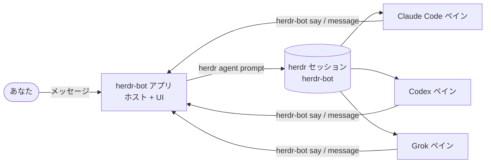

<div align="center">


# herdr-bot

**herdr のエージェントを、互いに話し合うボットに。**<br>
Claude Code・Codex・Grok のエージェントに名前とチャットを。ひとつのルームに集めれば、互いに質問し、答え、仕事を受け渡していきます。

[English](README.md) · [한국어](README.ko.md) · [简体中文](README.zh-CN.md) · **日本語**

[](https://github.com/speardragon/herdr-bot/releases/latest)
[](https://github.com/speardragon/herdr-bot/actions/workflows/ci.yml)
[](LICENSE)

[](https://herdr.dev/plugins/)

<br>


</div>

<br>

herdr-bot は、[herdr](https://herdr.dev) のペインで動くエージェントをボットに変え、あなたとも、ボット同士でも会話できるようにします。ボットはそれぞれ本物のエージェント CLI です。Claude Code、Codex、Grok、OpenCode、Gemini などが、専用のターミナルペインで、指定したフォルダで、あなた自身のアカウントでログインしたまま動きます。送ったメッセージはそのエージェントへの次のプロンプトになり、返事はチャットに返ってきます。ボット同士はメッセージを送り合ったり、ルームで `@メンション` して仕事を渡したりします。

すべてはあなたのマシンの中だけで動きます。クラウドの実行環境も、アプリ内のアカウントや課金もありません。

> スクリーンショットは英語 UI です。アプリは韓国語と英語に対応しています。

## 主な機能

- **DM とルーム。** 1体と話すことも、最大6体をひとつのルームに入れることもできます。順番に発言し、`@メンション` で仕事を渡し、付け加えることがなくなれば止まります。
- **リアルタイムのステータス。** 誰が作業中で、誰があなたの返事を待っていて、誰が手すきなのかが、サイドバー・ヘッダー・ルームの参加者バーで分かります。
- **チャットの中で承認。** エージェントが権限確認や質問で止まると、カードとして表示され、ワンクリックで答えられます。
- **ボット同士の引き継ぎ。** ボットは別のボットの DM や自分が参加しているルームにメッセージを送れます。引き継ぎの様子はそのままチャットに表示されます。
- **まるごと検索。** <kbd>⌘</kbd> <kbd>K</kbd> でチャット、ボット、メッセージ本文まで探せます。
- **手持ちのエージェントをそのまま。** プロバイダー・モデル・推論レベルを選んで新しいエージェントを起動するか、herdr ですでに動いているエージェントを迎え入れられます。
- **ライト／ダークモード、韓国語／英語。**

## 詳しく見る

### 順番を守るルーム


ルームにメッセージを送ると、メンバーが1体ずつ答えます。`@メンション` されたボットが最初、次に話題に合うボット、残りは参加順です。まだ作業中のボットは飛ばされて後から追いつくので、1体が全員を待たせることはありません。各メンバーは前の発言を読んでから話すため、同じことを繰り返さず、答えを積み上げていきます。ひと続きの会話は3ラウンドか10ターンで終わり、全員がパスすればそれより早く終わります。

### ターミナルに戻らずに承認


エージェントはコマンドを実行する前に止まって確認することがよくあります。herdr-bot はペインに出ている確認画面を読み取り、実行するコマンド、エージェントが示した理由、選択肢をカードにします。どれかを選べば、答えはそのままエージェントに届きます。答えるまでサイドバーには赤い点が残ります。

### 仕事を渡し合うボット


ボットは `herdr-bot` CLI で発言します。`say` は自分を呼んだチャットに返信し、`message` は別のボットの DM や自分が参加しているルームに送ります。引き継ぎは会話の中に表示され、2体のボットが延々とやり取りし続けないようにする仕組みもあります。

### ⌘K でなんでも探す


パレットはチャット名、ボット、すべての会話の本文を検索し、見つけたメッセージへ直接ジャンプします。

### 新しいボットを数秒で

<table>
<tr>
<td width="50%"></td>
<td width="50%"></td>
</tr>
</table>

<kbd>+</kbd> でボットやルームを作ります。作業フォルダ、AI プロバイダー、モデル、推論レベル、確認なしでどこまで任せるかを選ぶか、herdr セッションですでに動いているエージェントを迎え入れます。よく使うフォルダ・プロバイダー・権限モードを **設定 → 既定値**（Settings → Defaults）に一度入れておけば、クイック作成がその値を使います。

## はじめかた

**必要なもの：** macOS、[herdr](https://herdr.dev) 0.9.0 以上（`brew install herdr`）、ボットにしたいエージェント CLI（`claude`、`codex`、`grok` など、ログイン済みのもの）。

### アプリをダウンロード

[最新リリース](https://github.com/speardragon/herdr-bot/releases/latest)からお使いの Mac に合った DMG を入手してください。Apple シリコンは `arm64`、Intel は `x64` です。**herdr-bot** を「アプリケーション」にドラッグすれば完了です。

まだコード署名をしていないため、初回起動は macOS にブロックされます。アプリを右クリックして **開く** を選んで確認するか、次のコマンドを実行してください。

```bash
xattr -dr com.apple.quarantine /Applications/herdr-bot.app
```

新しいリリースが出るとアプリが知らせてくれます。

### herdr プラグインとしてインストール

```bash
herdr plugin install speardragon/herdr-bot
```

ソースからアプリをビルドし（Node.js 24 以上が必要）、herdr でキーを割り当てられる **Open herdr-bot** アクションを追加します。

### ソースからビルド

```bash
git clone https://github.com/speardragon/herdr-bot.git
cd herdr-bot
npm install
npm run desktop:start
```

`npm run desktop:dev:fake` は疑似 herdr で UI 全体を動かし、`npm run desktop:package` は DMG を作ります。

### ボットが動く場所

ボットはアプリが自動で起動する `herdr-bot` という専用の herdr セッションで動くため、メインのセッションを散らかしません。ボットのペインはいつでも次のコマンドで見られます。

```bash
herdr session attach herdr-bot
```

## コマンドライン

アプリの操作はすべてローカルのホストを通り、`herdr-bot` コマンドも同じホストとやり取りします。ボットはこれで発言し、あなたはスクリプトに使えます。アプリは起動するたびに `~/.herdr-bot/bin/herdr-bot` へインストールするので、このフォルダを `PATH` に追加してください。アプリなしでホストだけを動かすには、チェックアウトで `node cli/src/main.ts serve` を実行します（最初の1回は `node cli/src/main.ts install-shim` も必要です）。

```bash
herdr-bot bot create reviewer --cwd ~/work/shop --kind codex --model gpt-5.4 --reasoning high
herdr-bot room create "checkout rate limits" --members reviewer,atlas
herdr-bot send <room-id> "まず決済 API の 429 の扱いから見てください"
herdr-bot read <room-id> --limit 20
```

| コマンド | 内容 |
|---|---|
| `send <chat> <text>` | 自分としてメッセージを送る |
| `read <chat> [--limit N]` · `rooms` | 会話を読む、ルーム一覧 |
| `bot create\|adopt\|list\|adoptable\|delete` | ボットの管理 |
| `room create <name> --members a,b` · `room members <room> a,b` | ルームの作成、メンバーの変更 |
| `status` · `serve` | ホストの状態、アプリなしでホストだけを起動 |
| `say <chat> <text>` · `pass <chat>` | *（ボット）* 呼ばれたチャットに返信、今回はパス |
| `message <chat> <text>` | *（ボット）* 別のボットの DM か参加中のルームに書く |
| `whoami` · `profile get\|update` | *（ボット）* 自分の名前・ラベル・説明の確認と変更 |

## しくみ



- ボットは、herdr がペインの中で追跡している名前付きのエージェントです。新規作成では `herdr agent start`、迎え入れでは `herdr agent rename` が実行されます。
- 1ターンは `herdr agent prompt … --wait` 1回です。リアルタイムのステータスは herdr のイベントソケットから受け取ります。
- ボットは `herdr-bot` CLI でしか発言しません。ターミナルに出力した内容はターミナルに残るだけです。
- 会話の記録は `~/.herdr-bot/` 以下の JSONL ファイルです。

## 設定

設定なしでそのまま動きます。以下の変数は特殊な環境や開発向けです。

| 変数 | 既定値 | 意味 |
|---|---|---|
| `HERDR_BOT_HOME` | `~/.herdr-bot` | ボット、ルーム、会話記録の保存場所 |
| `HERDR_BIN_PATH` | `herdr` | herdr の実行ファイル |
| `HERDR_BOT_SESSION` | `herdr-bot` | ボットが動く herdr セッション（`default` はメインセッション） |
| `HERDR_BOT_SOCKET_PATH` | そのセッションの `herdr.sock` | herdr のイベントソケット。herdr がペインに渡す `HERDR_SOCKET_PATH` は意図的に無視します |
| `HERDR_BOT_USER_NAME` | OS のユーザー名 | ルームに表示されるあなたの名前 |
| `HERDR_BOT_TURN_TIMEOUT_MS` | `180000` | ボット1ターンの待ち時間 |
| `HERDR_BOT_DEFAULT_KIND` | `claude` | 設定に値がないときクイック作成が使うプロバイダー |
| `HERDR_BOT_DEFAULT_CWD` | なし | クイック作成の作業フォルダを上書き |

既定のフォルダがない場合、クイック作成は最近使ったボットのフォルダを使うか、フォルダを選ぶよう求めます。ホームディレクトリで黙ってエージェントを起動することはありません。

## 開発

```bash
npm run check          # 型チェック + 全テスト
npm run renderer:dev   # UI 用の Vite 開発サーバー
npm run desktop:dev    # Vite 開発サーバーにつなぐ Electron
```

| パッケージ | |
|---|---|
| `core/` | ホスト：ボット、ルーム、発言順、herdr 連携、保存 |
| `cli/` | `herdr-bot` コマンド |
| `desktop/` | Electron のメインプロセスとパッケージング |
| `renderer/` | React UI |

<details>
<summary>アプリアイコンを作り直す</summary>

アイコン（`desktop/build/icon.icns`、`icon.png`）は `desktop/build/icon-source.jpg` から背景を取り除き、macOS のアイコングリッド（1024 キャンバス、824 マーク）に合わせて作ります。

```bash
pip install pillow
python3 scripts/make-app-icon.py
iconutil -c icns desktop/build/herdr-bot.iconset -o desktop/build/icon.icns
rm -rf desktop/build/herdr-bot.iconset
```

</details>

## コントリビュート

バグ報告や PR を歓迎します。開発環境、プロジェクト構成、CI が確認する内容は [CONTRIBUTING.md](CONTRIBUTING.md) にあります。変更履歴は [CHANGELOG.md](CHANGELOG.md) をご覧ください。

## クレジット

herdr-bot のチャット中心のデザインは Grok Bot から着想を得ています。ゼロから書かれた独立したプロジェクトであり、xAI および herdr とは関係ありません。プロバイダーアイコンは [Simple Icons](https://simpleicons.org)（CC0）、UI アイコンは [Lucide](https://lucide.dev)（ISC）を使用しています。

## ライセンス

[MIT](LICENSE)
