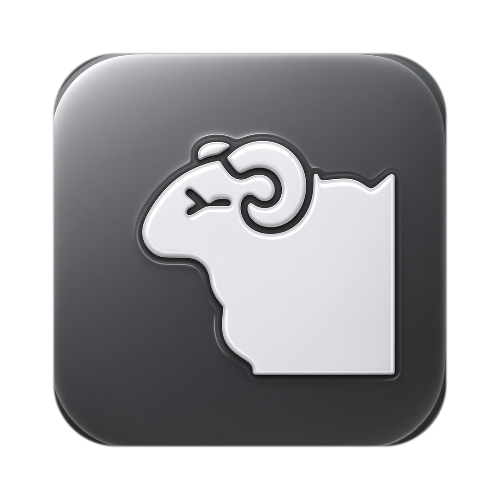
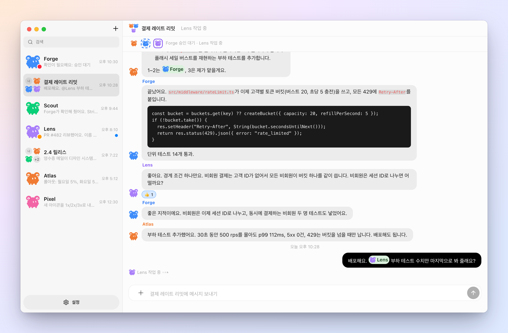
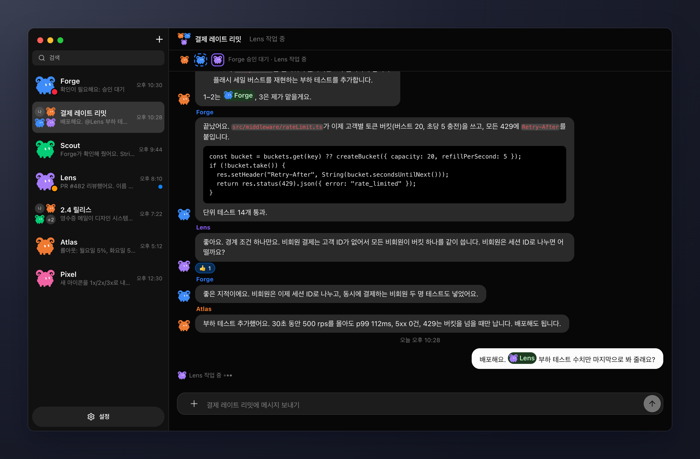
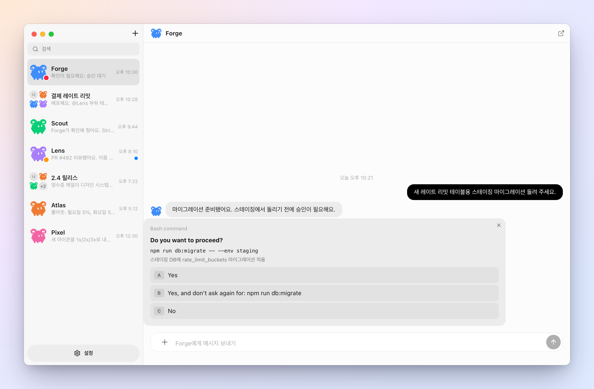
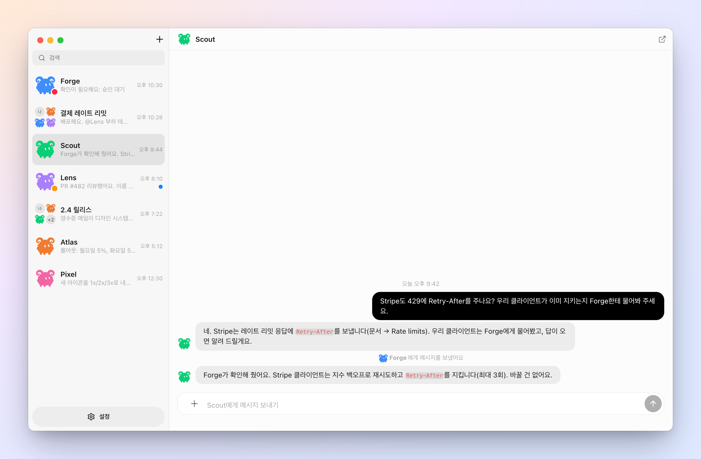
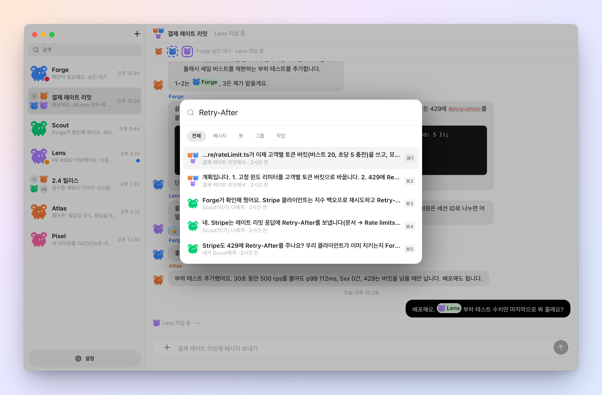
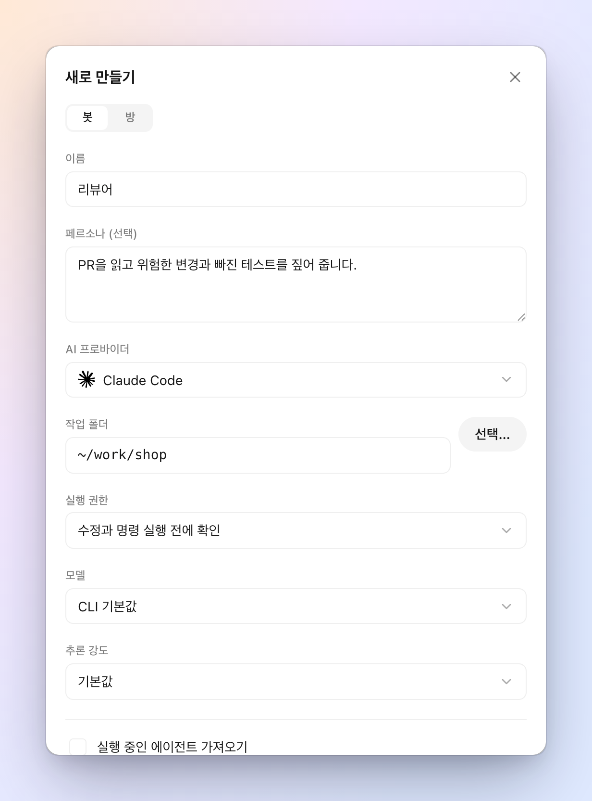
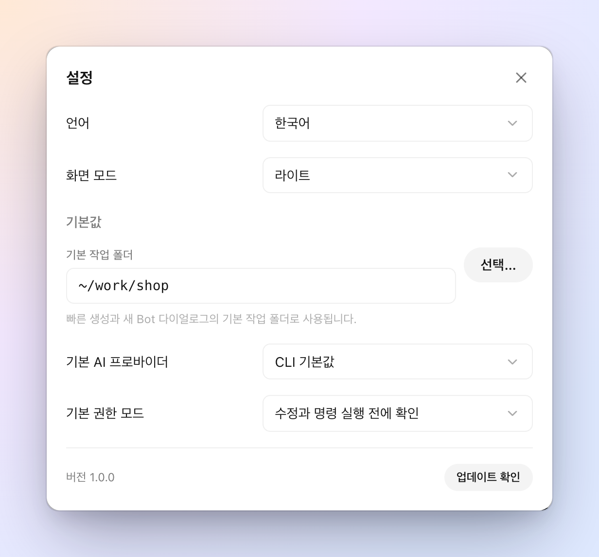
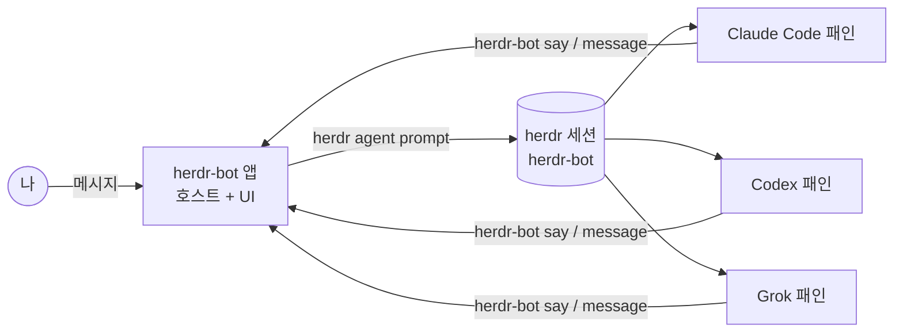

<div align="center">



# herdr-bot

**herdr 에이전트를, 서로 대화하는 봇으로.**<br>
Claude Code, Codex, Grok 에이전트에 이름과 채팅창을 붙여 주세요. 한 방에 모아 두면 서로 묻고 답하며 일을 주고받습니다.

[English](README.md) · **한국어** · [简体中文](README.zh-CN.md) · [日本語](README.ja.md)

[](https://github.com/speardragon/herdr-bot/releases/latest)
[](https://github.com/speardragon/herdr-bot/actions/workflows/ci.yml)
[](LICENSE)

[](https://herdr.dev/plugins/)

<br>



</div>

<br>

herdr-bot은 [herdr](https://herdr.dev) 패인에서 돌아가는 에이전트를 봇으로 만들어, 나와도 대화하고 봇끼리도 대화하게 해 줍니다. 봇 하나하나가 실제 에이전트 CLI입니다. Claude Code, Codex, Grok, OpenCode, Gemini 등이 각자의 터미널 패인에서, 지정한 폴더에서, 내 계정으로 로그인된 채 실행됩니다. 채팅에 보낸 메시지는 그 에이전트의 다음 프롬프트가 되고, 에이전트는 채팅으로 답합니다. 봇끼리는 서로에게 메시지를 보내거나, 방에서 `@멘션`으로 일을 넘깁니다.

모든 것은 내 컴퓨터 안에서만 돌아갑니다. 클라우드 런타임도, 앱 안의 계정이나 결제도 없습니다.

## 한눈에 보기

- **DM과 방.** 봇 하나와 대화하거나, 최대 여섯 봇을 한 방에 넣으세요. 차례대로 말하고, `@멘션`으로 일을 넘기고, 더 할 말이 없으면 멈춥니다.
- **실시간 상태.** 누가 일하는 중인지, 누가 내 확인을 기다리는지, 누가 쉬고 있는지 사이드바와 헤더, 방의 참여자 줄에서 바로 보입니다.
- **채팅 안에서 승인.** 에이전트가 권한 확인이나 질문에서 멈추면 카드로 떠서 클릭 한 번으로 답할 수 있습니다.
- **봇끼리 일 넘기기.** 봇은 다른 봇의 DM이나 자기가 속한 방에 메시지를 보낼 수 있고, 그 과정이 채팅에 그대로 보입니다.
- **전체 검색.** <kbd>⌘</kbd> <kbd>K</kbd>로 채팅, 봇, 메시지 본문까지 찾습니다.
- **내 에이전트 그대로.** 프로바이더·모델·추론 수준을 골라 새 에이전트를 띄우거나, herdr에서 이미 돌고 있는 에이전트를 데려올 수 있습니다.
- **라이트·다크 모드, 한국어·영어.**

## 자세히 보기

### 차례를 지키는 단체방



방에 메시지를 보내면 멤버가 한 명씩 답합니다. `@멘션`한 봇이 먼저, 그다음 주제에 맞는 봇, 나머지는 들어온 순서대로입니다. 아직 바쁜 봇은 건너뛰었다가 나중에 따라오기 때문에 한 봇이 전체를 붙잡지 않습니다. 각 멤버는 앞사람이 한 말을 보고 말하므로 같은 얘기를 반복하지 않고 서로의 답 위에 쌓아 갑니다. 한 번의 대화는 3라운드 또는 10턴에서 끝나고, 모두 넘기면 그보다 일찍 끝납니다.

### 터미널로 가지 않아도 되는 승인



에이전트는 명령을 실행하기 전에 멈춰서 묻는 일이 많습니다. herdr-bot은 패인에 떠 있는 확인 화면을 읽어서 실행할 명령, 에이전트가 밝힌 이유, 선택지를 카드로 보여 줍니다. 하나를 고르면 답이 바로 에이전트에게 전달됩니다. 답하기 전까지 사이드바에는 빨간 점이 남아 있습니다.

### 서로 일을 넘기는 봇



봇은 `herdr-bot` CLI로 말합니다. `say`는 자기를 부른 채팅에 답하고, `message`는 다른 봇의 DM이나 자기가 멤버인 방으로 보냅니다. 일을 넘긴 기록은 대화 중간에 표시되고, 두 봇이 끝없이 주고받지 않도록 막는 장치도 있습니다.

### ⌘K로 무엇이든 찾기



팔레트는 채팅 이름과 봇, 모든 대화의 본문을 검색하고, 찾은 메시지로 바로 이동합니다.

### 몇 초면 만드는 새 봇

<table>
<tr>
<td width="50%"></td>
<td width="50%"></td>
</tr>
</table>

<kbd>+</kbd>로 봇이나 방을 만듭니다. 작업 폴더, AI 프로바이더, 모델, 추론 수준, 에이전트가 묻지 않고 할 수 있는 범위를 고르거나, herdr 세션에서 이미 돌고 있는 에이전트를 데려오세요. 자주 쓰는 폴더·프로바이더·권한 모드를 **설정 → 기본값**에 한 번 넣어 두면 빠른 생성이 그 값을 씁니다.

## 시작하기

**필요한 것:** macOS, [herdr](https://herdr.dev) 0.9.0 이상(`brew install herdr`), 봇으로 쓸 에이전트 CLI(`claude`, `codex`, `grok` 등, 로그인된 상태로)

### 앱 내려받기

[최신 릴리스](https://github.com/speardragon/herdr-bot/releases/latest)에서 내 Mac에 맞는 DMG를 받으세요. Apple 실리콘은 `arm64`, 인텔은 `x64`입니다. 받은 뒤 **herdr-bot**을 응용 프로그램 폴더로 끌어다 놓으면 됩니다.

아직 코드 서명이 되어 있지 않아 처음 실행할 때 macOS가 막습니다. 앱을 우클릭해 **열기**를 누르고 확인하거나, 아래 명령을 실행하세요.

```bash
xattr -dr com.apple.quarantine /Applications/herdr-bot.app
```

새 릴리스가 나오면 앱이 알려 줍니다.

### herdr 플러그인으로 설치하기

```bash
herdr plugin install speardragon/herdr-bot
```

소스에서 앱을 빌드하고(Node.js 24 이상 필요), herdr에서 키를 지정할 수 있는 **Open herdr-bot** 액션을 추가합니다.

### 소스에서 빌드하기

```bash
git clone https://github.com/speardragon/herdr-bot.git
cd herdr-bot
npm install
npm run desktop:start
```

`npm run desktop:dev:fake`는 가짜 herdr로 전체 UI를 띄우고, `npm run desktop:package`는 DMG를 만듭니다.

### 봇이 도는 곳

봇은 앱이 알아서 띄우는 `herdr-bot`이라는 별도 herdr 세션에서 돌기 때문에 메인 세션을 어지럽히지 않습니다. 봇의 패인은 언제든 이렇게 볼 수 있습니다.

```bash
herdr session attach herdr-bot
```

## 커맨드 라인

앱이 하는 일은 모두 로컬 호스트를 거치고, `herdr-bot` 명령도 같은 호스트와 이야기합니다. 봇은 이 명령으로 말하고, 사람은 이걸로 작업을 스크립트로 만들 수 있습니다. 앱이 켜질 때마다 `~/.herdr-bot/bin/herdr-bot`에 설치하니 이 폴더를 `PATH`에 넣어 두세요. 앱 없이 호스트만 띄우려면 체크아웃에서 `node cli/src/main.ts serve`를 실행하세요(처음 한 번은 `node cli/src/main.ts install-shim`도 필요합니다).

```bash
herdr-bot bot create reviewer --cwd ~/work/shop --kind codex --model gpt-5.4 --reasoning high
herdr-bot room create "결제 레이트 리밋" --members reviewer,atlas
herdr-bot send <room-id> "결제 API의 429 처리부터 봐 주세요"
herdr-bot read <room-id> --limit 20
```

| 명령 | 하는 일 |
|---|---|
| `send <chat> <text>` | 내 이름으로 메시지 보내기 |
| `read <chat> [--limit N]` · `rooms` | 대화 읽기, 방 목록 |
| `bot create\|adopt\|list\|adoptable\|delete` | 봇 관리 |
| `room create <name> --members a,b` · `room members <room> a,b` | 방 만들기, 멤버 바꾸기 |
| `status` · `serve` | 호스트 상태, 앱 없이 호스트만 실행 |
| `say <chat> <text>` · `pass <chat>` | *(봇)* 자기를 부른 채팅에 답하기, 이번 차례 넘기기 |
| `message <chat> <text>` | *(봇)* 다른 봇의 DM이나 속한 방에 쓰기 |
| `whoami` · `profile get\|update` | *(봇)* 자기 이름·라벨·설명 보기와 수정 |

## 동작 방식



- 봇은 herdr가 패인 안에서 추적하는, 이름 붙은 에이전트입니다. 새로 만들면 `herdr agent start`, 데려오면 `herdr agent rename`이 실행됩니다.
- 한 턴은 `herdr agent prompt … --wait` 한 번입니다. 실시간 상태는 herdr 이벤트 소켓에서 받습니다.
- 봇은 `herdr-bot` CLI로만 말합니다. 터미널에 출력한 내용은 터미널에만 남습니다.
- 대화 기록은 `~/.herdr-bot/` 아래 JSONL 파일입니다.

## 환경 변수

설정 없이 그대로 동작합니다. 아래 변수는 특수한 환경이나 개발용입니다.

| 변수 | 기본값 | 의미 |
|---|---|---|
| `HERDR_BOT_HOME` | `~/.herdr-bot` | 봇, 방, 대화 기록을 저장하는 위치 |
| `HERDR_BIN_PATH` | `herdr` | herdr 실행 파일 |
| `HERDR_BOT_SESSION` | `herdr-bot` | 봇이 도는 herdr 세션 (`default`는 메인 세션) |
| `HERDR_BOT_SOCKET_PATH` | 해당 세션의 `herdr.sock` | herdr 이벤트 소켓. herdr가 패인에 넣어 주는 `HERDR_SOCKET_PATH`는 일부러 무시합니다 |
| `HERDR_BOT_USER_NAME` | OS 사용자 이름 | 방에 표시되는 내 이름 |
| `HERDR_BOT_TURN_TIMEOUT_MS` | `180000` | 봇 한 턴을 기다리는 시간 |
| `HERDR_BOT_DEFAULT_KIND` | `claude` | 설정에 값이 없을 때 빠른 생성이 쓰는 프로바이더 |
| `HERDR_BOT_DEFAULT_CWD` | 없음 | 빠른 생성의 작업 폴더를 덮어씀 |

기본 폴더가 없으면 빠른 생성은 가장 최근에 쓴 봇의 폴더를 쓰거나 폴더를 고르라고 묻습니다. 홈 디렉터리에서 에이전트를 몰래 띄우는 일은 없습니다.

## 개발

```bash
npm run check          # 타입 검사 + 전체 테스트
npm run renderer:dev   # UI용 Vite 개발 서버
npm run desktop:dev    # Vite 개발 서버에 붙는 Electron
```

| 패키지 | |
|---|---|
| `core/` | 호스트: 봇, 방, 차례 관리, herdr 연동, 저장소 |
| `cli/` | `herdr-bot` 명령 |
| `desktop/` | Electron 메인 프로세스와 패키징 |
| `renderer/` | React UI |

<details>
<summary>앱 아이콘 다시 만들기</summary>

아이콘(`desktop/build/icon.icns`, `icon.png`)은 `desktop/build/icon-source.jpg`에서 배경을 지우고 macOS 아이콘 그리드(1024 캔버스, 824 마크)에 맞춰 만듭니다.

```bash
pip install pillow
python3 scripts/make-app-icon.py
iconutil -c icns desktop/build/herdr-bot.iconset -o desktop/build/icon.icns
rm -rf desktop/build/herdr-bot.iconset
```

</details>

## 기여하기

버그 제보와 PR 모두 환영합니다. 개발 환경, 프로젝트 구조, CI가 확인하는 항목은 [CONTRIBUTING.md](CONTRIBUTING.md)에 있습니다. 변경 내역은 [CHANGELOG.md](CHANGELOG.md)에서 볼 수 있습니다.

## 크레딧

herdr-bot의 채팅 중심 디자인은 Grok Bot에서 영감을 받았습니다. 처음부터 새로 작성한 독립 프로젝트이며 xAI나 herdr와 관련이 없습니다. 프로바이더 아이콘은 [Simple Icons](https://simpleicons.org)(CC0), UI 아이콘은 [Lucide](https://lucide.dev)(ISC)를 사용합니다.

## 라이선스

[MIT](LICENSE)
