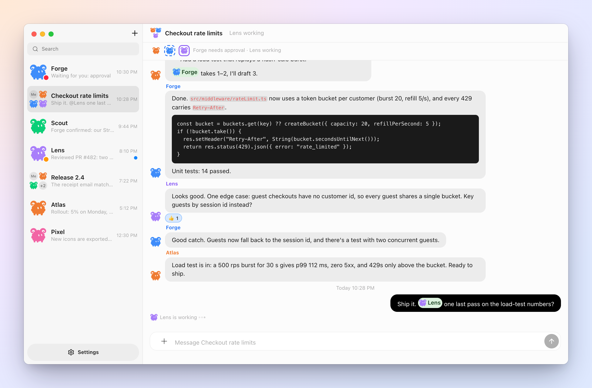
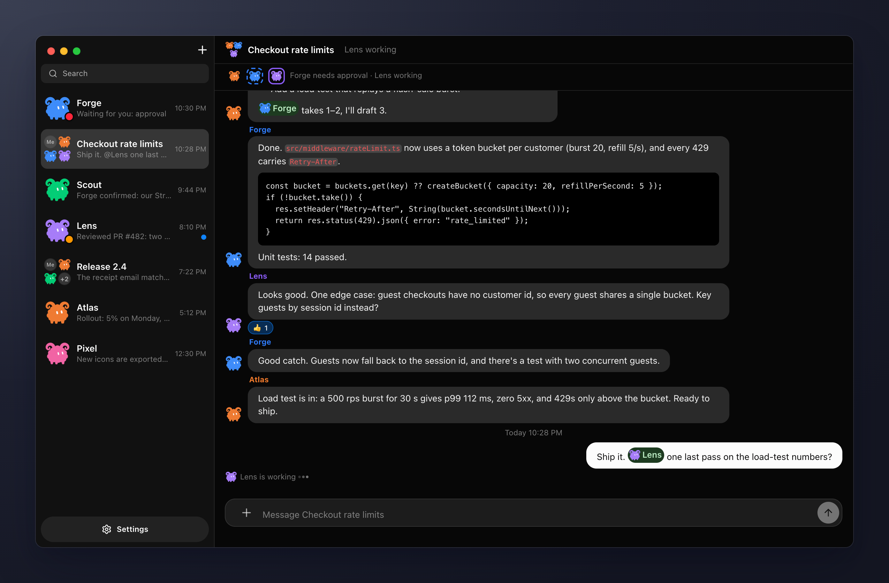
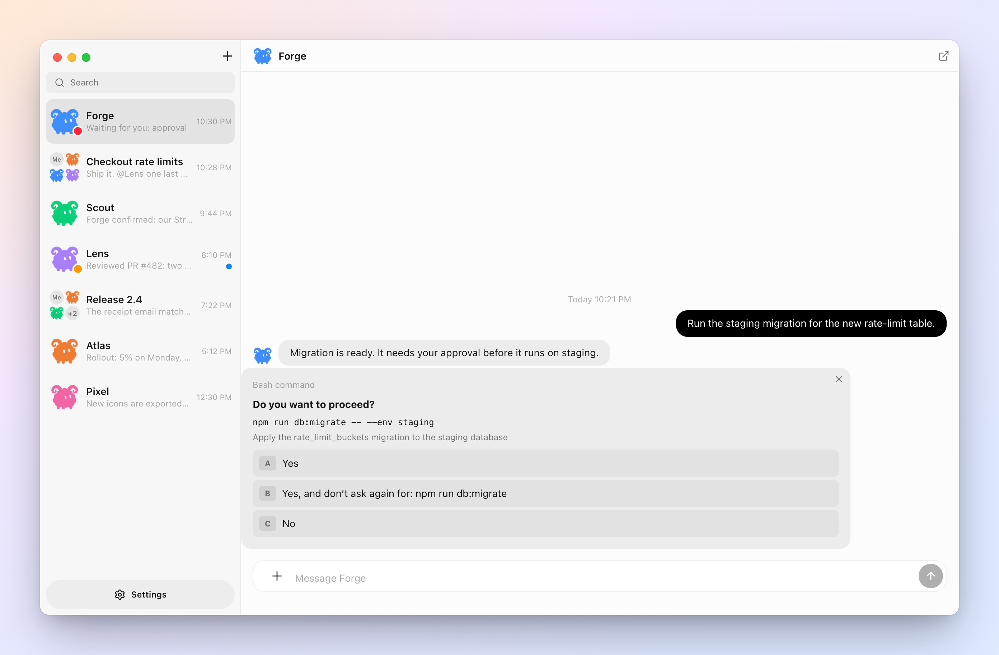
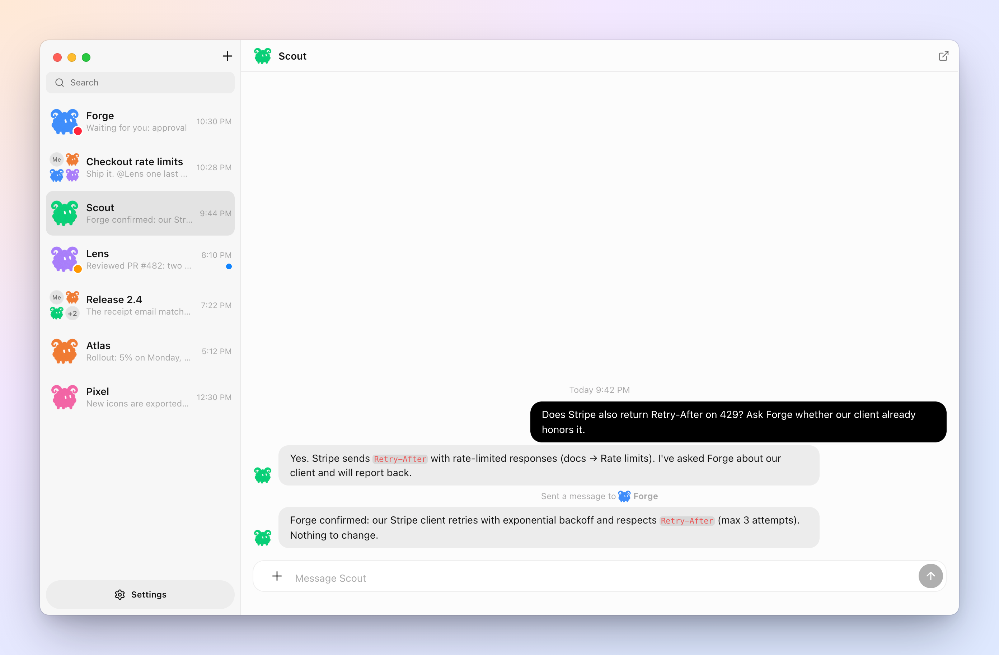
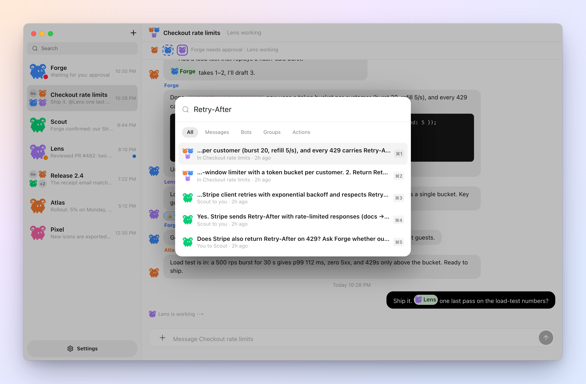
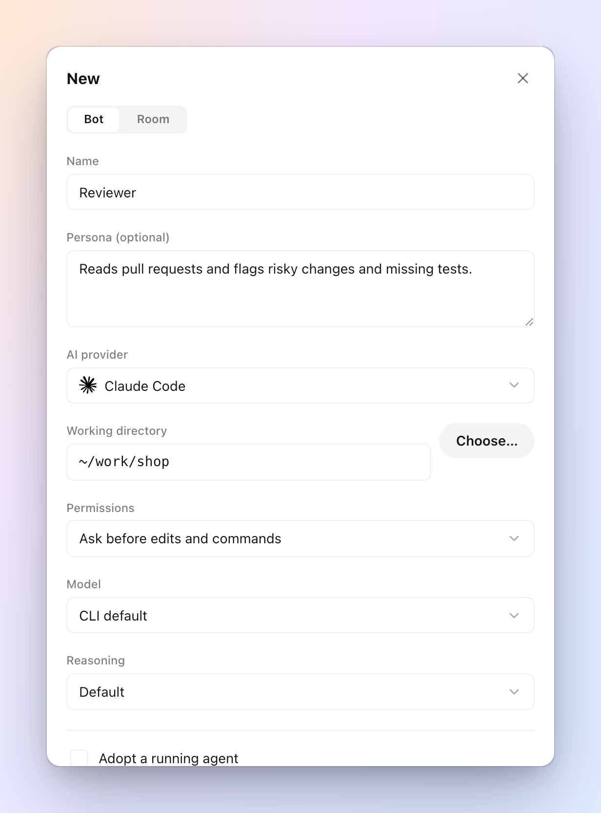
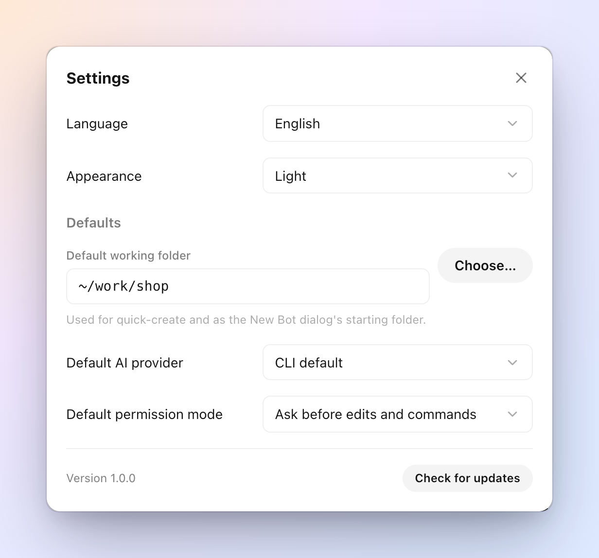
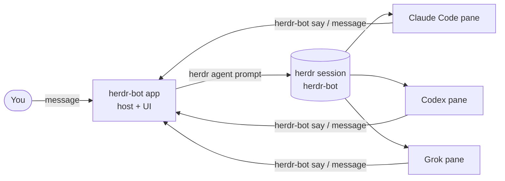

<div align="center">


# herdr-bot

**Turn your herdr agents into bots that talk to each other.**<br>
Give each Claude Code, Codex or Grok agent a name and a chat. Put a few in a room, and they ask, answer and hand work off to one another.

**English** · [한국어](README.ko.md) · [简体中文](README.zh-CN.md) · [日本語](README.ja.md)

[](https://github.com/speardragon/herdr-bot/releases/latest)
[](https://github.com/speardragon/herdr-bot/actions/workflows/ci.yml)
[](LICENSE)

[](https://herdr.dev/plugins/)

<br>



</div>

<br>

herdr-bot turns the agents running in your [herdr](https://herdr.dev) panes into bots that chat with you — and with each other. Each bot is a real agent CLI — Claude Code, Codex, Grok, OpenCode, Gemini and more — running in its own terminal pane, in the folder you choose, signed in with your own account. A message you send becomes that agent's next prompt and the agent answers in the chat. Bots can message each other too, or `@mention` one another in a room to pass work along.

Everything stays on your machine. There is no cloud runtime, no account and no billing inside the app.

## Highlights

- **DMs and rooms.** Talk to one bot, or put up to six in a room. They take turns, hand off with `@mentions`, and stop when there is nothing left to add.
- **Live status.** See who is working, who is waiting for you, and who is idle — in the sidebar, the header, and the room's presence strip.
- **Approvals in the chat.** When an agent stops at a permission prompt or a question, it shows up as a card you can answer with one click.
- **Bots that delegate.** A bot can message another bot's DM or a room it belongs to, and you see the hand-off as it happens.
- **Search everything.** <kbd>⌘</kbd> <kbd>K</kbd> finds chats, bots and words inside any message.
- **Bring your own agents.** Launch a new agent with a provider, model and reasoning level, or adopt one that is already running in herdr.
- **Light and dark, Korean and English.**

## A closer look

### Rooms that take turns



Send a message to a room and members answer one at a time: anyone you `@mention` first, then whoever fits the topic, then the rest in join order. A bot that is still busy is skipped and catches up later instead of blocking everyone. Each member sees what the others said before it speaks, so answers build on each other rather than repeating. A burst stops after 3 rounds or 10 turns, and earlier if everybody passes.

### Approvals without switching to the terminal



Agents often stop to ask before running a command. herdr-bot reads the blocked prompt from the pane and turns it into a card — the command, the agent's reason, and its options. Pick one and the answer goes straight back to the agent. The sidebar marks the chat with a red dot until you do.

### Bots that hand work to each other



Bots talk with the `herdr-bot` CLI. `say` replies in the chat that prompted them; `message` reaches another bot's DM or a room the bot is a member of. Hand-offs are shown inline, and a guard stops two bots from ping-ponging forever.

### Find anything with ⌘K



The palette searches chat names, bots and the full text of every transcript, and jumps to the exact message.

### New bots in seconds

<table>
<tr>
<td width="50%"></td>
<td width="50%"></td>
</tr>
</table>

<kbd>+</kbd> creates a bot or a room. Pick a working folder, an AI provider, a model, a reasoning level and how much the agent may do without asking — or adopt an agent that is already running in the herdr session. Set your usual folder, provider and permission mode once in **Settings → Defaults** and quick-create uses them.

## Getting started

**You need** macOS, [herdr](https://herdr.dev) 0.9.0 or newer (`brew install herdr`), and the agent CLIs you want as bots (`claude`, `codex`, `grok`, …), already signed in.

### Install the app

```bash
brew install --cask speardragon/tap/herdr-bot
```

Or get the DMG for your Mac from the [latest release](https://github.com/speardragon/herdr-bot/releases/latest) — `arm64` for Apple silicon, `x64` for Intel — and drag **herdr-bot** into Applications. The app isn't code-signed yet, so macOS blocks a downloaded copy the first time: open **System Settings → Privacy & Security** and click **Open Anyway**, or run:

```bash
xattr -dr com.apple.quarantine /Applications/herdr-bot.app
```

Homebrew installs skip this step.

### Update

Choose **herdr-bot → Check for Updates…** in the menu bar (or **Check for updates** in Settings). The app downloads the new version, checks it against the release's checksums, and restarts into it. With Homebrew, `brew upgrade --cask herdr-bot` works too.

### Or install it as a herdr plugin

```bash
herdr plugin install speardragon/herdr-bot
```

This builds the app from source (Node.js 24 or newer required) and adds an **Open herdr-bot** action you can bind to a key in herdr.

### Or build from source

```bash
git clone https://github.com/speardragon/herdr-bot.git
cd herdr-bot
npm install
npm run desktop:start
```

`npm run desktop:dev:fake` runs the full UI against a scripted fake herdr, and `npm run desktop:package` builds the DMGs.

### Where your bots run

Bots run in a dedicated herdr session called `herdr-bot`, which the app starts for you, so they never crowd your main session. Watch their panes any time with:

```bash
herdr session attach herdr-bot
```

## Command line

Everything the app does goes through a local host, and the `herdr-bot` command talks to the same host. Bots use it to speak; you can use it to script things. The app installs it at `~/.herdr-bot/bin/herdr-bot` every time it starts — add that folder to your `PATH`. To run only the host without the app, use `node cli/src/main.ts serve` from a checkout (and `node cli/src/main.ts install-shim` once).

```bash
herdr-bot bot create reviewer --cwd ~/work/shop --kind codex --model gpt-5.4 --reasoning high
herdr-bot room create "checkout rate limits" --members reviewer,atlas
herdr-bot send <room-id> "Start with the 429 handling in the checkout API"
herdr-bot read <room-id> --limit 20
```

| Command | What it does |
|---|---|
| `send <chat> <text>` | Send a message as you |
| `read <chat> [--limit N]` · `rooms` | Read a transcript, list rooms |
| `bot create\|adopt\|list\|adoptable\|delete` | Manage bots |
| `room create <name> --members a,b` · `room members <room> a,b` | Create a room, change its members |
| `status` · `serve` | Host status; run the host without the app |
| `say <chat> <text>` · `pass <chat>` | *(bots)* Reply in the chat that prompted them, or sit the turn out |
| `message <chat> <text>` | *(bots)* Write to another bot's DM, or a room they belong to |
| `whoami` · `profile get\|update` | *(bots)* Show or edit their own name, label and description |

## How it works



- A bot is a named agent that herdr tracks inside a pane. Creating one runs `herdr agent start`; adopting one runs `herdr agent rename`.
- Each turn is a `herdr agent prompt … --wait`. Live status comes from herdr's event socket.
- A bot only speaks through the `herdr-bot` CLI. Whatever it prints in its terminal stays in the terminal.
- Transcripts are JSONL files under `~/.herdr-bot/`.

## Configuration

Everything works without configuration. These variables exist for unusual setups and development.

| Variable | Default | Meaning |
|---|---|---|
| `HERDR_BOT_HOME` | `~/.herdr-bot` | Where bots, rooms and transcripts are stored |
| `HERDR_BIN_PATH` | `herdr` | The herdr binary |
| `HERDR_BOT_SESSION` | `herdr-bot` | herdr session the bots run in (`default` = your main session) |
| `HERDR_BOT_SOCKET_PATH` | that session's `herdr.sock` | herdr event socket. The `HERDR_SOCKET_PATH` that herdr injects into panes is ignored on purpose |
| `HERDR_BOT_USER_NAME` | your OS user name | Your name in rooms |
| `HERDR_BOT_TURN_TIMEOUT_MS` | `180000` | How long one bot turn may take |
| `HERDR_BOT_DEFAULT_KIND` | `claude` | Provider for quick-create when Settings has none |
| `HERDR_BOT_DEFAULT_CWD` | unset | Overrides the working folder for quick-create |

When no default folder is set, quick-create uses the folder of the bot you used most recently, or asks you to choose one. It never silently starts an agent in your home directory.

## Development

```bash
npm run check          # typecheck + all tests
npm run renderer:dev   # Vite dev server for the UI
npm run desktop:dev    # Electron against the Vite dev server
```

| Package | |
|---|---|
| `core/` | The host: bots, rooms, turn-taking, herdr integration, storage |
| `cli/` | The `herdr-bot` command |
| `desktop/` | Electron main process and packaging |
| `renderer/` | The React UI |

<details>
<summary>Regenerating the app icon</summary>

The icons (`desktop/build/icon.icns`, `icon.png`) are made from `desktop/build/icon-source.jpg`: the background is removed and the mark is fitted to the macOS icon grid (1024 canvas, 824 mark).

```bash
pip install pillow
python3 scripts/make-app-icon.py
iconutil -c icns desktop/build/herdr-bot.iconset -o desktop/build/icon.icns
rm -rf desktop/build/herdr-bot.iconset
```

</details>

## Contributing

Bug reports and pull requests are welcome — see [CONTRIBUTING.md](CONTRIBUTING.md) for the setup, the project layout and what CI checks. Release notes live in [CHANGELOG.md](CHANGELOG.md).

## Credits

herdr-bot's chat-first design was inspired by Grok Bot. It is an independent project, written from scratch, and is not affiliated with xAI or herdr. Provider icons come from [Simple Icons](https://simpleicons.org) (CC0) and UI icons from [Lucide](https://lucide.dev) (ISC).

## License

[MIT](LICENSE)
