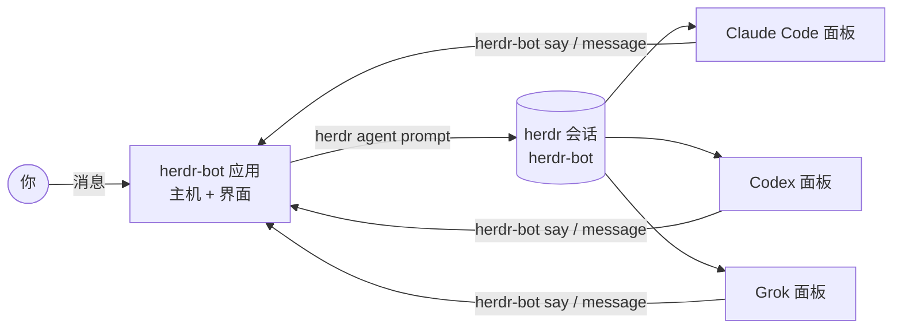

<div align="center">


# herdr-bot

**让你的 herdr 智能体变成能互相对话的 bot。**<br>
给每个 Claude Code、Codex 或 Grok 智能体一个名字和一个聊天窗口。把几个拉进同一个群，它们会互相提问、回答、交接工作。

[English](README.md) · [한국어](README.ko.md) · **简体中文** · [日本語](README.ja.md)

[](https://github.com/speardragon/herdr-bot/releases/latest)
[](https://github.com/speardragon/herdr-bot/actions/workflows/ci.yml)
[](LICENSE)

[](https://herdr.dev/plugins/)

<br>


</div>

<br>

herdr-bot 把运行在 [herdr](https://herdr.dev) 面板里的智能体变成 bot —— 既能和你聊天，也能彼此对话。每个 bot 都是一个真实的智能体 CLI —— Claude Code、Codex、Grok、OpenCode、Gemini 等 —— 在各自的终端面板中、在你指定的目录下、用你自己的账号运行。你发出的消息就是它的下一条提示词，它的回复会回到聊天里。bot 之间也可以互发消息，或在群里用 `@提及` 把工作交给对方。

一切都只在你的电脑上运行。没有云端运行环境，应用内也没有账号和付费。

> 截图为英文界面。应用支持韩语和英语。

## 亮点

- **私信与群聊。** 和一个 bot 单聊，或者把最多六个 bot 放进一个群。它们轮流发言，用 `@提及` 交接工作，没有新内容时就停下来。
- **实时状态。** 谁在工作、谁在等你、谁在空闲，在侧边栏、标题栏和群成员状态条上一目了然。
- **在聊天里审批。** 智能体停在权限确认或提问时，会以卡片形式出现，点一下就能回答。
- **bot 之间互相委派。** bot 可以给另一个 bot 的私信或自己所在的群发消息，交接过程会直接显示在聊天中。
- **全局搜索。** <kbd>⌘</kbd> <kbd>K</kbd> 可以搜索聊天、bot 以及任意消息的正文。
- **用你自己的智能体。** 选择提供商、模型和推理强度启动新智能体，或者接管 herdr 中已经在运行的智能体。
- **浅色与深色模式，韩语与英语界面。**

## 功能详解

### 会轮流发言的群聊


在群里发消息后，成员会一个一个回答：先是你 `@提及` 的 bot，然后是最适合这个话题的，其余按加入顺序。仍在忙的 bot 会被跳过，稍后再跟上，不会卡住所有人。每个成员发言前都能看到前面的人说了什么，所以回答是层层递进，而不是重复。一轮对话最多 3 回合或 10 次发言，如果大家都选择跳过，会更早结束。

### 不用切回终端的审批


智能体在执行命令前经常会停下来询问。herdr-bot 读取面板中被阻塞的提示，把要执行的命令、智能体给出的理由和选项做成卡片。选一个，答案就直接发回给智能体。在你回答之前，侧边栏会一直显示红点。

### 互相交接工作的 bot


bot 通过 `herdr-bot` CLI 发言。`say` 回复到调用它的聊天，`message` 发送到另一个 bot 的私信或它所在的群。交接记录会显示在对话中，并且有保护机制防止两个 bot 无休止地来回对话。

### 用 ⌘K 找到一切


命令面板可以搜索聊天名称、bot 以及所有对话的全文，并直接跳转到对应的消息。

### 几秒钟创建新 bot

<table>
<tr>
<td width="50%"></td>
<td width="50%"></td>
</tr>
</table>

<kbd>+</kbd> 用来新建 bot 或群聊。选择工作目录、AI 提供商、模型、推理强度，以及智能体无需询问就能做哪些事 —— 或者接管 herdr 会话中已经在运行的智能体。在 **设置 → 默认值**（Settings → Defaults）里设好常用的目录、提供商和权限模式，快速创建就会直接使用。

## 快速开始

**环境要求：** macOS、[herdr](https://herdr.dev) 0.9.0 或更高版本（`brew install herdr`），以及想用作 bot 的智能体 CLI（`claude`、`codex`、`grok` 等，并已登录）。

### 安装应用

```bash
brew install --cask speardragon/tap/herdr-bot
```

或者从[最新版本](https://github.com/speardragon/herdr-bot/releases/latest)下载适合你的 Mac 的 DMG —— Apple 芯片选 `arm64`，Intel 选 `x64` —— 然后把 **herdr-bot** 拖进“应用程序”。应用目前还没有代码签名，下载的副本首次打开会被 macOS 拦截：打开 **系统设置 → 隐私与安全性**，点击 **仍要打开**，或者运行：

```bash
xattr -dr com.apple.quarantine /Applications/herdr-bot.app
```

用 Homebrew 安装则不需要这一步。

### 更新

在菜单栏选择 **herdr-bot → Check for Updates…**（设置里的 **Check for updates** 也一样）。应用会下载新版本，用发布的校验和核对后重启到新版本。用 Homebrew 安装的话，`brew upgrade --cask herdr-bot` 也可以。

### 作为 herdr 插件安装

```bash
herdr plugin install speardragon/herdr-bot
```

这会从源码构建应用（需要 Node.js 24 或更高版本），并添加一个可以在 herdr 中绑定快捷键的 **Open herdr-bot** 操作。

### 从源码构建

```bash
git clone https://github.com/speardragon/herdr-bot.git
cd herdr-bot
npm install
npm run desktop:start
```

`npm run desktop:dev:fake` 会用模拟的 herdr 运行完整界面，`npm run desktop:package` 会构建 DMG。

### bot 运行在哪里

bot 运行在名为 `herdr-bot` 的独立 herdr 会话中（由应用自动启动），不会挤占你的主会话。随时可以这样查看它们的面板：

```bash
herdr session attach herdr-bot
```

## 命令行

应用的所有操作都经过一个本地主机进程，`herdr-bot` 命令连接的也是同一个主机。bot 用它发言，你可以用它写脚本。应用每次启动时都会把它安装到 `~/.herdr-bot/bin/herdr-bot`，把这个目录加入 `PATH` 即可。如果只想运行主机而不打开应用，在仓库中运行 `node cli/src/main.ts serve`（第一次还需要运行 `node cli/src/main.ts install-shim`）。

```bash
herdr-bot bot create reviewer --cwd ~/work/shop --kind codex --model gpt-5.4 --reasoning high
herdr-bot room create "checkout rate limits" --members reviewer,atlas
herdr-bot send <room-id> "先看一下结账 API 的 429 处理"
herdr-bot read <room-id> --limit 20
```

| 命令 | 作用 |
|---|---|
| `send <chat> <text>` | 以你的身份发送消息 |
| `read <chat> [--limit N]` · `rooms` | 读取对话记录、列出群聊 |
| `bot create\|adopt\|list\|adoptable\|delete` | 管理 bot |
| `room create <name> --members a,b` · `room members <room> a,b` | 创建群聊、修改成员 |
| `status` · `serve` | 主机状态；不启动应用、只运行主机 |
| `say <chat> <text>` · `pass <chat>` | *（bot）* 回复调用它的聊天，或跳过本轮 |
| `message <chat> <text>` | *（bot）* 发到另一个 bot 的私信或所在的群 |
| `whoami` · `profile get\|update` | *（bot）* 查看或修改自己的名称、标签和描述 |

## 工作原理



- bot 是 herdr 在面板中跟踪的具名智能体。新建时执行 `herdr agent start`，接管时执行 `herdr agent rename`。
- 每一轮发言就是一次 `herdr agent prompt … --wait`。实时状态来自 herdr 的事件套接字。
- bot 只能通过 `herdr-bot` CLI 发言，打印在终端里的内容只会留在终端。
- 对话记录以 JSONL 文件保存在 `~/.herdr-bot/` 下。

## 配置

无需任何配置即可使用。以下变量用于特殊环境和开发。

| 变量 | 默认值 | 含义 |
|---|---|---|
| `HERDR_BOT_HOME` | `~/.herdr-bot` | bot、群聊和对话记录的存放位置 |
| `HERDR_BIN_PATH` | `herdr` | herdr 可执行文件 |
| `HERDR_BOT_SESSION` | `herdr-bot` | bot 所在的 herdr 会话（`default` 即主会话） |
| `HERDR_BOT_SOCKET_PATH` | 该会话的 `herdr.sock` | herdr 事件套接字。herdr 注入到面板中的 `HERDR_SOCKET_PATH` 会被刻意忽略 |
| `HERDR_BOT_USER_NAME` | 系统用户名 | 你在群聊中显示的名字 |
| `HERDR_BOT_TURN_TIMEOUT_MS` | `180000` | 单次 bot 发言的等待时间 |
| `HERDR_BOT_DEFAULT_KIND` | `claude` | 设置中未指定时快速创建使用的提供商 |
| `HERDR_BOT_DEFAULT_CWD` | 未设置 | 覆盖快速创建的工作目录 |

没有设置默认目录时，快速创建会使用最近用过的 bot 的目录，或者请你选择一个。它绝不会悄悄在你的主目录里启动智能体。

## 开发

```bash
npm run check          # 类型检查 + 全部测试
npm run renderer:dev   # 界面的 Vite 开发服务器
npm run desktop:dev    # 连接 Vite 开发服务器的 Electron
```

| 包 | |
|---|---|
| `core/` | 主机：bot、群聊、轮流发言、herdr 集成、存储 |
| `cli/` | `herdr-bot` 命令 |
| `desktop/` | Electron 主进程与打包 |
| `renderer/` | React 界面 |

<details>
<summary>重新生成应用图标</summary>

图标（`desktop/build/icon.icns`、`icon.png`）由 `desktop/build/icon-source.jpg` 生成：去掉背景，并按 macOS 图标网格（1024 画布、824 标志）对齐。

```bash
pip install pillow
python3 scripts/make-app-icon.py
iconutil -c icns desktop/build/herdr-bot.iconset -o desktop/build/icon.icns
rm -rf desktop/build/herdr-bot.iconset
```

</details>

## 参与贡献

欢迎提交问题和 PR。开发环境、项目结构以及 CI 检查的内容见 [CONTRIBUTING.md](CONTRIBUTING.md)。版本变更记录见 [CHANGELOG.md](CHANGELOG.md)。

## 致谢

herdr-bot 以聊天为中心的设计受到 Grok Bot 的启发。它是一个从零编写的独立项目，与 xAI 及 herdr 均无关联。提供商图标来自 [Simple Icons](https://simpleicons.org)（CC0），界面图标来自 [Lucide](https://lucide.dev)（ISC）。

## 许可证

[MIT](LICENSE)
